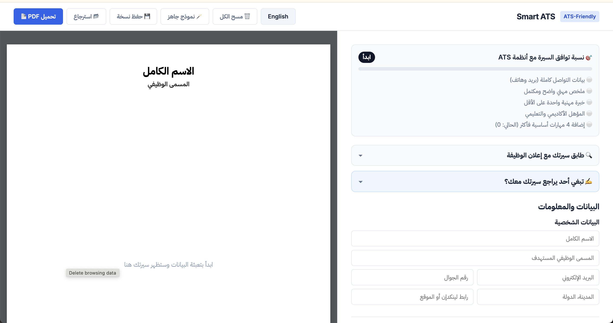
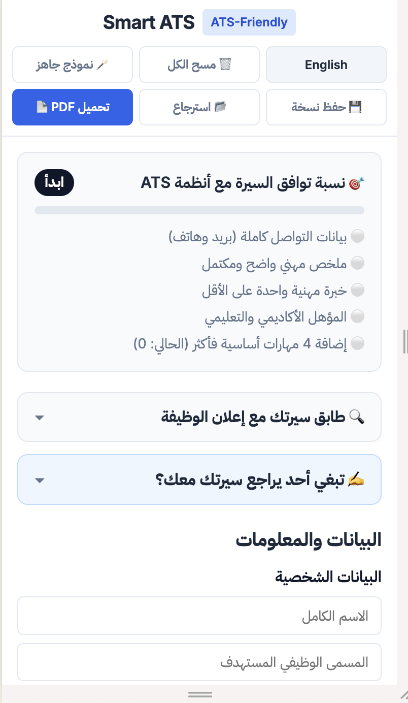

# 📄 Smart ATS CV

A free, privacy-first resume builder for Arabic and English job seekers. It produces a clean, single-column resume with real selectable text (the format applicant tracking systems read best) and compares your resume against a job description to show which keywords are missing.

🌐 **Live:** [smartatscv.com](https://smartatscv.com)



---

## ✨ Features

- **Live A4 preview** that updates as you type
- **Arabic & English** with full RTL/LTR switching; the chosen language is remembered across pages
- **PDF export with real, selectable text** (via print stylesheet), not an image
- **Job-description matcher:** paste a job post and see which keywords your resume has and which are missing
- **Resume readiness meter** (contact info, summary, experience, education, skills)
- **Save / restore** your resume as a JSON file
- **Private by design:** everything runs in the browser; no server, no account, no resume data leaves your device
- **Responsive:** works on desktop and mobile

| Desktop | Mobile |
|---|---|
|  |  |

---

## 🛠️ Tech Stack

- **HTML5, CSS3, vanilla JavaScript** (no framework, no build step)
- **GitHub Pages** with a custom domain (`CNAME`)
- **Google Fonts** (IBM Plex Sans Arabic, Inter)

---

## 🧠 Technical decisions

**Why `window.print()` instead of a PDF library?**
Libraries like html2canvas + jsPDF render the page as an image, which ATS software cannot read. A print stylesheet (`@media print`, `@page`, `break-inside: avoid`) keeps the text as real text and gives precise control over page size, margins and page breaks.

**Why no framework?**
The app is small and client-side only. Vanilla JS keeps the bundle tiny and loading fast, and avoids a build pipeline for a project of this size.

**State and rendering.**
The resume lives in three in-memory arrays (experience, education, certifications) plus the form fields. Each input event updates the state, re-renders the preview, recalculates the readiness score, and saves a draft to `localStorage`.

**Security.**
User input is escaped (`esc()`) before being inserted into the DOM, and the newer modules build content with `textContent`, to prevent XSS and broken markup.

**Language handling.**
All UI strings live in a `translations` object. The selected language is stored in `localStorage` (`ats_lang`) and shared with the privacy page, so the choice persists across pages.

---

## 📁 Project structure

```
├── index.html        # App markup (form + A4 preview + footer)
├── style.css         # UI styles, print stylesheet, mobile layout
├── script.js         # State, rendering, scoring, i18n, storage
├── ats-match.js      # Job-description keyword matcher + backup/restore
├── ats-service.js    # Optional manual-review service card
├── privacy.html      # Bilingual privacy policy
├── ads.txt · robots.txt · sitemap.xml · CNAME
```

---

## 🚀 Run locally

```bash
git clone https://github.com/Romytha1/ats-resume-builder.git
cd ats-resume-builder
```

Open `index.html` in a browser, or serve the folder with any static server (for example the VS Code **Live Server** extension).

---

## ⚠️ Limitations & roadmap

Honest notes on what this project does and does not do:

- The **readiness score** measures resume completeness; it is not a guarantee of passing any specific ATS (each ATS works differently).
- The keyword matcher compares words literally; it does not yet understand synonyms (e.g. `JS` = `JavaScript`) or Arabic morphology.
- Single resume template.
- All logic is in a few global scripts; no automated tests yet.

**Planned**
- [ ] Split `script.js` into ES modules (state / render / storage / i18n)
- [ ] Unit tests (Vitest) for scoring and matching
- [ ] Synonym-aware matching
- [ ] Additional single-column templates and DOCX export
- [ ] Accessibility audit (Lighthouse)
- [ ] Mobile "Edit | Preview" tabs

---

## 👩‍💻 Author

**Romytha Mohammed** · Frontend Developer
[Portfolio](https://romytha1.github.io/portfolio/) · [GitHub](https://github.com/romytha1) · [LinkedIn](https://www.linkedin.com/in/romytha-mohammed-3291292aa)

Feedback and suggestions are welcome: open an issue or email romytham1@gmail.com.
